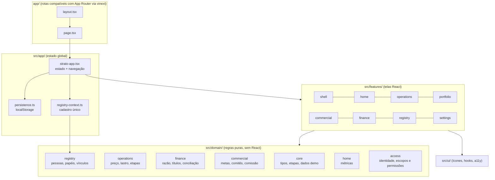
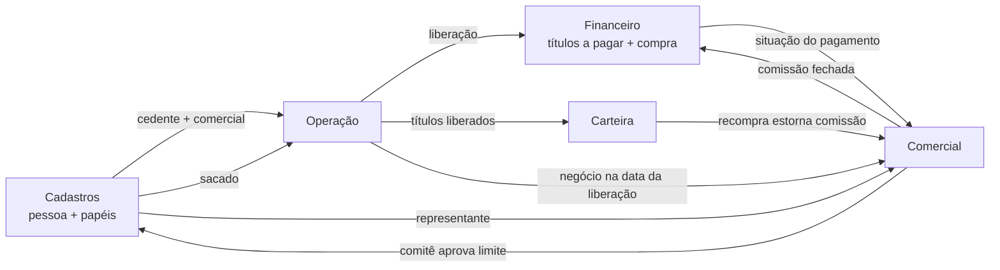

# Arquitetura do STRATO

Plataforma operacional de recebíveis (factoring, securitizadora, FIDC) em React e Vite/vinext, com APIs no mesmo processo Node e PostgreSQL privado. No ambiente autenticado, operações, recebíveis, carteira, financeiro, cadastros, políticas, tarefas e acesso são persistidos no servidor. O `localStorage` operacional pertence exclusivamente à demonstração explícita; preferências visuais podem permanecer locais. Login, cadastro, sessões e aprovação pertencem ao STRATO; o Supabase Auth não participa da aplicação.

## 1. Visão em camadas



Regras de dependência (valem como contrato):

| Camada             | Pode importar                                                                                                                                                       | Não pode importar                          |
| ------------------ | ------------------------------------------------------------------------------------------------------------------------------------------------------------------- | ------------------------------------------ |
| `src/domain`       | outros módulos de `src/domain`                                                                                                                                      | React, `src/features`, `src/app`, `src/ui` |
| `src/features/<x>` | `src/domain`, `src/ui`, `src/app/registry-context`, `src/features/shell/shell-context` e peças compartilhadas de outra feature quando explícito (ex.: `finance-ui`) | estado de outra feature                    |
| `src/app`          | tudo acima                                                                                                                                                          | —                                          |
| `app/` (rotas)     | `src/app`, `src/features/shell/theme`                                                                                                                               | —                                          |

Isso deixa o domínio testável sem navegador (ver `tests/`) e permite trocar a origem dos dados sem mexer nas telas.

## 2. Mapa de pastas

```
app/                         Rotas do Next (página única) e CSS global
  layout.tsx                 Fontes, metadados, script de tema antes da pintura
  page.tsx                   Monta <StratoApp />
  globals.css                Índice dos estilos (ver seção 6)
  styles/                    tokens.generated.css, legacy.css, commercial.css, design-system.css, ledger.css
src/
  app/
    strato-app.tsx           Raiz: estado global, navegação por view, providers
    persistence.ts           Chaves e migração do localStorage
    registry-context.ts      Contexto do cadastro único (cedentes, pessoas, comercial)
  domain/
    core/                    Entidades (types.ts), etapas (stages.ts), formatação, dados de demonstração (demo/)
    operations/              Precificação, lastro, diagnóstico por etapa, ritmo, automação, criação da operação
    finance/                 Plano de contas (model.ts), razão (ledger.ts), títulos, bancos, liberações,
                             relatórios, conciliação OFX, importação de plano de contas, implantação
    commercial/              Tipos, calendário, regras (atribuição, métricas, comissão), ações, seed
    registry/                Pessoas e papéis (parties.ts), gravação com propagação (party-save.ts),
                             vínculo cedente↔comercial e eventos da carteira (registry.ts)
    home/                    Métricas da Visão geral e parâmetros (metas, cenários)
    risk/                    Índice de qualidade explicável, política de qualidade (pesos, faixas, PDD,
                             parâmetros dos indicadores), rolagem, safras, concentração (HHI) e cobrança
    indicators/              Indicadores de mercado por tela (carteira, originação, esteira, comercial,
                             financeiro, cadastro), funções puras com teste em tests/indicators.test.ts
    access/                  Usuários, identidade autenticada, visão simulada, escopos e permissões por módulo/ação
  features/
    shell/                   Barra superior com módulos (menu responsivo: Plataforma ▾, painel no tablet,
                             folha no celular), menu do usuário (empresa e tema), busca Ctrl K, alertas
    home/                    Visão geral (perfis Gestão, Operação, Risco)
    operations/              Central, Nova operação e o workspace com as 6 etapas
      central/ new-operation/ workspace/ entry/ risk/ lastro/ pricing/ approval/ release/ components/
    portfolio/               Carteira (títulos, por cedente, por comercial, atraso)
    commercial/              Comercial (painel, carteira, negócios, contas novas, visitas, funil, comitês, comissões)
    finance/                 Financeiro (caixa, títulos, liberações, extrato, conciliação, contábil, bancos)
    registry/                Cadastros (pessoas com papéis, cedentes, sacados)
    settings/                Usuários e acesso, empresas, padrões, políticas, integrações e preferências
    risk/                    Painel de Risco: qualidade dos clientes, cobrança, rolagem, safras, critérios
    indicators/              IndicatorGrid (grade de indicadores com a fonte de cada número)
  ui/                        Ícones, pressable (a11y), useElementWidth
tests/                       Vitest: documentos, cadastro, preço, financeiro, comercial
tools/theme_tokens.py        Gera tokens claro/escuro a partir de cores literais do CSS
tools/sites-vite-plugin.ts   Empacota os metadados opcionais da hospedagem no build
docs/                        Arquitetura, testes, plano de IA e referências do produto
```

Cada arquivo começa com um comentário dizendo o que ele faz. Nenhum arquivo de componente passa de ~700 linhas; os painéis grandes foram divididos em subcomponentes, um hook de estado (`use-*.ts`) e um modelo puro (`*-model.ts`) na mesma pasta.

## 3. Estado, persistência e navegação

`src/app/strato-app.tsx` coordena a cópia da interface; no ambiente autenticado a autoridade é o servidor. As chaves abaixo são da demonstração (e preferências), não o armazenamento operacional de produção:

| Estado                              | Tipo                    | Chave no localStorage           |
| ----------------------------------- | ----------------------- | ------------------------------- |
| operações                           | `Operation[]`           | `lastro-mvp-operations-v3`      |
| sacados                             | `Debtor[]`              | `lastro-mvp-debtors-v1`         |
| financeiro                          | `FinanceState`          | `strato-finance-v2`             |
| comercial                           | `CommercialState`       | `strato-commercial-v1`          |
| pessoas do Cadastro                 | `Party[]`               | `strato-parties-v1`             |
| usuários e acessos                  | `AccessState`           | `strato-access-v1`              |
| tarefas e notificações              | `TaskState`             | `strato-tasks-v1`               |
| explicações na interface            | `boolean`               | `lastro-interface-guidance-v1`  |
| tema, perfil/período da Visão geral | preferências do usuário | `strato-theme`, `strato-home-*` |

A trilha de decisões usa `app/api/decisions/route.ts`: tenant, sessão, permissão, alçada e chave de idempotência são validados antes de `src/server/decisions/repository.ts` gravar eventos versionados no PostgreSQL privado. As migrações em `supabase/migrations/` criam o ledger imutável, a deduplicação e a outbox; evento, reivindicação idempotente e mensagem pendente são gravados na mesma transação. `src/server/outbox/publisher.ts` entrega as mensagens para `decision_notifications`, aplica backoff, encerra após cinco falhas e resolve tarefas por novos eventos. A interface aciona o publicador autenticado para atualização imediata; o agendamento externo pode reutilizar o mesmo serviço.

Os repositórios em `src/server/operations`, `finance` e `portfolio` persistem agregados versionados, projeções e eventos. Transições financeiras coordenadas usam uma transação PostgreSQL com bloqueio consultivo por tenant (`src/server/database/transactions.ts`), seguido de verificação de versão e idempotência. A liberação grava operação, recebíveis, compra contábil e obrigação financeira conjuntamente. Baixa de recebível usa intenção em `/api/portfolio/settlements` e atualiza carteira, caixa e razão no servidor. A interface autenticada não gera essas projeções por efeitos React. Testes com adaptadores em memória verificam coordenação, mas não substituem homologação de SQL/concorrência em PostgreSQL isolado.

Comandos de aprovação e configuração de alçadas têm endpoints próprios, evidências materiais e eventos. Documentos são bytes privados com manifesto, hash, tenant e vínculo de operação em `src/server/documents`; a implantação precisa de volume privado persistente compartilhado entre instâncias. Remessas e retornos CNAB400 Itaú/Bradesco usam comandos especializados, reservas de numeração e eventos bancários; contrato e limites estão em [integrations/CNAB400.md](integrations/CNAB400.md).

O diretório de identidade e autorização também é sincronizado com o PostgreSQL por `app/api/access/users/route.ts`. A autenticação pertence ao STRATO: a pessoa cria uma solicitação com senha, permanece pendente e só entra depois de um administrador definir departamento, função, empresas, permissões e alçadas. `src/server/access/password.ts` aplica PBKDF2 com sal individual; `src/server/access/session.ts` emite token opaco em cookie `HttpOnly` e persiste somente o hash; `src/server/access/repository.ts` resolve vínculo, escopo, permissões e alçadas, além de bloquear tentativas repetidas. O bootstrap automático de demonstração existe somente em `localhost`; a primeira credencial externa é criada pelo comando administrativo de uso único.

O ambiente definitivo usa o projeto Supabase `STRATO`, na região de São Paulo, exclusivamente como PostgreSQL gerenciado. As migrações em `supabase/migrations/` criam o esquema `private`, não exposto diretamente pela Data API, com credenciais internas, sessões opacas, diretório de acesso, ledger, idempotência, outbox e notificações. `src/server/database/postgres.ts` mantém um pool pequeno, conexão criptografada e comandos sem prepared statements para compatibilidade com o pooler. O navegador não carrega cliente, chave pública, sessão do Supabase Auth ou conexão do banco.

- Acesso administrativo (decisão de produto de 19/10/2026): administrador ativo recebe o catálogo completo de permissões no servidor e na interface, inclusive em cadastros legados incompletos. A edição do diretório por administrador vigente pode ser salva diretamente, com auditoria, sem aprovação de uma segunda pessoa. A autoridade é lida do banco antes da alteração, nunca do perfil enviado pelo navegador. Demais perfis mantêm concessões explícitas e o fluxo independente para ampliações críticas. Escopos empresariais, vínculo ao tenant e alçadas financeiras continuam explícitos. A interface confirma a gravação pelo servidor e exibe erros; o diretório não é mais salvo silenciosamente por efeito global. O endpoint legado de solicitação também aplica diretamente mudanças de administrador vigente; pendências antigas podem ser decididas por esse administrador inclusive quando ele é solicitante ou beneficiário, mantendo comparação contra o perfil original e auditoria. A API de notificações projeta as solicitações pendentes por tenant, com ID estável e visibilidade para administradores ou gestor solicitante; a resolução remove o alerta sem depender de worker ou de recriar a solicitação.
- Na demonstração, a restauração acontece uma vez, depois de montar (`loadPersistedState`), e mescla o que foi salvo com os dados fictícios atuais (migração tolerante a campos novos). O ambiente autenticado carrega APIs por tenant e escopo.
- IA: `private.intelligence_states.used_tokens` é o contador da competência UTC `AAAA-MM`, retornada como `budgetPeriod`. O repositório abre o mês sob lock da linha do tenant na primeira leitura autorizada ou reserva, preservando o consumo legado na adoção inicial. `private.domain_events` mantém os agregados `IntelligenceBudgetPeriod` (marcadores mensais) e `IntelligenceBudgetReservation` (reserva e liquidação por chamada), com autoria da sessão. Reserva/ajuste e evento compartilham a mesma transação; o provedor é chamado fora dela. Liquidação persistente é idempotente, e uma chamada antiga só altera seu próprio histórico após a virada mensal. Falha ambígua mantém a reserva, sem liberação por timeout.
- "Restaurar dados de demonstração" (busca global) chama `clearPersistedState` e recria o seed.
- A navegação usa `view` e aceita links diretos controlados por permissão; `selected` abre o workspace de uma operação autorizada.

Dois contextos descem da raiz:

- `ShellContext` (`features/shell/shell-context.ts`): operações, navegar, abrir operação, nova operação, preferências, restaurar demonstração. Usado pelo shell, pela busca e pelos alertas.
- `RegistryContext` (`app/registry-context.ts`): cedentes efetivos (limite do comitê aplicado), pessoas do Cadastro, estado comercial com os eventos da carteira e as ações `saveParty` e `onCommercial`.

## 4. Vínculos entre módulos (ciclo fechado)



Regras implementadas (arquivo de referência entre parênteses):

- O CNPJ/CPF é a chave de tudo; uma pessoa pode ter vários papéis (`domain/registry/parties.ts`).
- Gravar um cadastro propaga: sacado entra na digitação, representante vira comercial, cedente cria ou transfere o vínculo com o comercial (`domain/registry/party-save.ts`).
- O limite do cedente vem da decisão do comitê (`effectiveCedents` em `domain/registry/registry.ts`).
- A operação grava o comercial responsável quando nasce (`domain/operations/create-operation.ts`); o negócio conta na data da liberação para o dono do cliente naquela data (`repAt`, `liveDeals` em `domain/commercial/rules.ts`).
- Liberação gera títulos a pagar e o lançamento da compra (`domain/finance/releases.ts`).
- Recompras feitas nas operações viram eventos da carteira e estornam comissão (`repurchaseEvents` + `computeCommission`).

## 5. Padrões do domínio

A preparação e o envio da OP ao financeiro podem ser feitos pelo mesmo usuário com `operations:edit`, preservando autoria e validações. O envio gera pagamentos pendentes; registrar ou estornar o pagamento exige `finance:release`.

- **Funções puras que devolvem resultado:** ações retornam `{ state, error?, message?, effects? }` (`Result` no financeiro, `CResult` no comercial). A tela aplica o novo estado ou mostra o erro; nada lança exceção para a interface.
- **Transação no financeiro:** `run(state, fn)` trabalha num rascunho (`draftOf`), e `post` recusa lançamento desbalanceado. Se qualquer passo falha, o estado original fica intacto.
- **Nada é apagado:** títulos são excluídos com motivo e estorno, baixas são estornadas por contrapartida, operações são canceladas com memória, cadastros são inativados.
- **Diário financeiro imutável:** a persistência recusa alteração ou remoção de lançamentos, inclusive em períodos abertos. O único vínculo acrescentável ao lançamento existente é o estorno, com contrapartida integral na mesma empresa e referências recíprocas; depois de registrado, esse vínculo também é preservado. A comparação ignora a ordem das chaves JSON. A importação do plano não pode reclassificar partidas históricas: deve preservar seus códigos ou acrescentar contas, evitando divergência entre o snapshot e as partidas normalizadas.
- **Uma fonte por cálculo:** a precificação (`domain/operations/pricing.ts`) é a mesma para Preço, Aprovação, Visão geral e Comercial; o parser monetário (`parseMoneyBR`) é único no financeiro.
- **Condução individual da OP:** o criador pode aprovar a própria operação quando possui as permissões e alçadas exigidas. O preparador pode enviar a liberação ao financeiro com `operations:edit`, sem segundo usuário obrigatório; o servidor preserva autoria, validações e obrigações pendentes. Registrar ou estornar pagamentos continua restrito a `finance:release`. Essa separação permite concluir a OP sem confundir envio com execução do pagamento.
- **Datas** em ISO `AAAA-MM-DD` no estado; formatação `dd/mm/aaaa` só na tela.

## 6. Estilos e tema

`app/globals.css` importa, nesta ordem:

1. `styles/tokens.generated.css` — cada cor das telas legadas vira `var(--c-<papel>-<hex>)` com valor claro e escuro, gerados por `tools/theme_tokens.py` a partir do papel da cor (texto, fundo, borda, destaque). Não editar à mão.
2. `styles/legacy.css` — estilos das telas de operação, Visão geral (`vg-`) e Financeiro (`fn-`).
3. `styles/commercial.css` — Comercial (`cm-`).
4. `styles/design-system.css` — tokens semânticos `--ds-*`, shell (`sx-`), componentes novos (`ds-`, `rg-`, `pf-`).
5. `styles/ledger.css` — padrão visual atual (v10): barra superior com módulos em ícones, títulos grandes com trilha, bloco de caixa da Visão geral, cartões sem borda, abas de texto, gauge e o tratamento comum dos módulos.

Estilos novos usam os tokens `--ds-*`, que já têm valor claro e escuro. O tema é `data-theme="light|dark"` no `<html>`, com a preferência do usuário (claro, escuro ou sistema) salva em `strato-theme`.

## 7. Testes e qualidade

```
npm run check     # typecheck + lint + formatação + testes
npm test          # Vitest (tests/*.test.ts)
```

- Testes cobrem as regras que mais custam caro se quebrarem: dígitos de CPF/CNPJ, validação e propagação do cadastro, métodos de deságio, partidas dobradas e estorno, parser monetário, atribuição e comissão.
- ESLint roda sem erros nem avisos. As poucas exceções (`eslint-disable`) têm o motivo escrito ao lado — em geral, restauração do localStorage depois de montar.
- O servidor Node, as rotas e o adaptador PostgreSQL participam do typecheck; o build de produção valida os pacotes RSC, SSR e cliente.

## 8. Como fazer mudanças comuns

- **Nova regra de negócio:** escreva a função em `src/domain/<área>/`, sem React, com teste em `tests/`. A tela só chama a função.
- **Nova tela num módulo:** crie o componente em `src/features/<módulo>/` (ou numa subpasta da etapa) e ligue na aba ou na etapa correspondente.
- **Novo módulo no menu:** acrescente a `view` em `AppView` (`shell-context.ts`), o item em `navigation.tsx` e o `case` de renderização em `strato-app.tsx`.
- **Novo papel no Cadastro:** acrescente em `PartyRole`, `partyRoles`, `PartyRoleData` e `defaultRoleData` (`parties.ts`), a ficha em `party-role-fields.tsx` e as colunas em `parties-tab.tsx`.
- **Nova persistência operacional:** mantenha seeds restritos à demonstração; crie a API autenticada, escopo, repositório versionado e testes de conflitos. Funções de domínio permanecem independentes do navegador.
- **Implantar a inteligência assistiva:** siga [architecture/PLANO_ESTRUTURA_IA.md](./architecture/PLANO_ESTRUTURA_IA.md). O modelo interpreta e redige; consultas, cálculos, políticas, alçadas e ações continuam em serviços determinísticos e auditáveis.

## 9. Limitações conhecidas

- Alterações locais e testes não confirmam publicação, recuperação de backup ou compatibilidade das migrações com um banco remoto. A demonstração em localhost permanece alternativa explícita.
- Receita, SEFAZ, bureau e assinatura eletrônica dependem de provedores e evidência efetiva; configuração ativa não comprova consulta oficial. Anexos de assinatura manual são preservados, sem afirmar validação jurídica ou homologação de fornecedor.
- CNAB400 Itaú e Bradesco tem geração e interpretação locais com layouts restritos; homologação bancária, carteira/convênio contratado e ocorrências suportadas precisam ser confirmados antes do uso real.
- Importações suportadas e limitações aparecem na interface; planilhas binárias exigem conversão para CSV. OCR e novas modalidades de integração exigem implementação própria.
- A ordem de evolução está em [architecture/PLANO_ESTRUTURA_IA.md](./architecture/PLANO_ESTRUTURA_IA.md).

## 10. Copiloto: dados, comportamento e aprendizado

Arquitetura aprovada e publicada em 18/10/2026. `src/server/copilot/sources.ts` carrega fontes completas do tenant e aplica permissões de módulo e empresa. `operational-sources.ts` reutiliza os filtros oficiais de Financeiro, Comercial e tarefas nominais; registros comerciais sem vínculo com uma empresa identificável não entram na projeção. A rota não recorre a seeds em organizações sem dados. Os clientes HTTP compartilhados de `src/app/intelligence-client.ts` são uma dependência explícita permitida da feature Copiloto.

- **Dados:** `domain/copilot/analytics.ts` agrupa por CPF/CNPJ e calcula saldo, quantidade e participação em centavos sobre o conjunto autorizado completo. Ordenação por quantidade e por valor são intenções distintas; vencidos têm saldo positivo e vencimento anterior à data de São Paulo. Homônimos, ausência de documento, filtros não suportados e perguntas históricas recebem aviso ou esclarecimento. `operational-data.ts` fornece consultas delimitadas de títulos financeiros, visitas, comitês e tarefas. `registry-facts.ts` impede que zeros do adaptador cadastral sejam afirmados como histórico, score ou uso de limite conhecidos. `policy-query.ts` mostra somente bindings cadastrados, ativos e vigentes.
- **Comportamento:** `behavior.ts`, `behavior-sources.ts` e `operational-sources.ts` projetam observações, confirmações de lastro, cobranças, promessas, pagamentos, decisões operacionais, ledger, histórico financeiro, visitas, comitês e tarefas. Fontes oficiais permanecem canônicas; a projeção nunca altera a decisão. Novas anotações, avaliações, orientações e correções ficam em `private.copilot_memories`, privadas por padrão, com entidade, empresa, autor e validade inicial de 90 dias.
- **Aprendizado:** memória estruturada, sem treinamento de modelo. Correções exatas de intenção e orientações só são reutilizáveis após revisão por outra pessoa com `settings:manage`, mantendo o alcance empresarial e as evidências. Conflitos de interpretação não viram alias. Padrões sobre promessas exigem ao menos três títulos distintos; pagamento em data posterior ao contato não é prova de cumprimento integral nem de causalidade. Revisões são eventos append-only; revogação e expiração removem a memória do uso atual. Aprendizado não modifica preço, elegibilidade, limite ou alçada.
- **Respostas:** a IA interpreta somente intenção em JSON limitado; não fornece números nem fatos para a resposta. Intenções novas sugeridas pelo modelo pedem confirmação antes da consulta. Perguntas conhecidas e aliases revisados usam motores determinísticos, mesmo sem IA. Isso substitui a síntese numérica sobre listas truncadas, que não garantia cobertura ou precisão. Resumo e “Ver mais” compartilham o mesmo snapshot em `private.copilot_reports`; histórico é privado ao autor. Atualização usa a consulta estruturada e preserva/substitui filtros explicitamente. Recuperação revalida permissões, empresas e referências atuais, inclusive política e tarefas delegadas.
- **Fronteira externa:** nenhuma busca aberta, bureau ou enriquecimento cadastral é oferecido ao modelo. A autorização demonstrativa de bureau não é usada na Mesa real. `market.ts` permite, opcionalmente por `STRATO_MARKET_INDICATORS_ENABLED=true`, somente chamadas GET para séries fixas BCB/SGS, sem pergunta ou dados do cliente na requisição e sem redirecionamentos. [CDI, série 12](https://www3.bcb.gov.br/sgspub/consultarvalores/consultarValoresSeries.do?method=consultarSeries&series=12) mantém unidade diária; [meta Selic, série 432](https://www3.bcb.gov.br/sgspub/consultarvalores/consultarValoresSeries.do?method=consultarSeries&series=432) mantém unidade anual. Falhas, datas futuras, conversões e indicadores ainda não conectados não são preenchidos pelo modelo. O provedor de interpretação continua sujeito à reserva de orçamento server-side existente.

`20261018054805_copilot_evidence_memory.sql` cria snapshots, memórias e revisões no schema privado, com RLS forçada, privilégios públicos revogados e triggers contra alteração/remoção do histórico. É uma migração nova; não substitui migrações aplicadas. Foi executada em PostgreSQL isolado de teste, e aplicada ao banco remoto na publicação autorizada (registro em `docs/deployments/2026-10-18-copilot.md`). O código e a migração precisam ser publicados juntos; ausência das tabelas retorna indisponibilidade explícita, sem usar dados fictícios. O histórico completo de pagamentos, previsões estatísticas, OCR e novos indicadores não são inferidos da posição atual.
