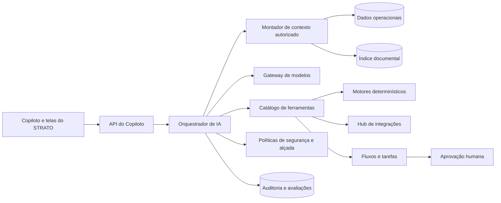

# Plano técnico da estrutura de IA

Status: plano técnico v1 concluído; execução incremental iniciada pela fundação IA-0
Versão: 1.0 · 10/10/2026  
Escopo: Copiloto operacional, Mesa Inteligente e processamento assistido de documentos

## 1. Objetivo

Construir uma camada de inteligência assistiva para o STRATO capaz de:

- entender perguntas em linguagem natural e consultar dados autorizados;
- receber e classificar documentos operacionais;
- extrair dados com evidência e nível de confiança;
- resumir dossiês, mudanças, riscos e pendências;
- explicar resultados do motor de políticas em linguagem simples;
- simular cenários sem alterar silenciosamente os dados oficiais;
- sugerir e, quando autorizado, executar ações operacionais controladas;
- manter fonte, regra, versão, usuário e resultado de cada interação.

A IA não calcula preço, elegibilidade, limite, concentração, tributo ou alçada por conta própria. Esses resultados
continuam sendo produzidos pelos motores determinísticos e versionados do STRATO. A IA interpreta a intenção,
seleciona ferramentas autorizadas e apresenta os resultados.

## 2. Estado atual

### Já existe no protótipo

- Copiloto flutuante integrado à interface.
- Perguntas sobre carteira, cedentes, sacados, operações e políticas.
- Respostas acompanhadas da fonte consultada.
- Mesa Inteligente com progresso em segundo plano simulado.
- Cenários versionados para inclusão e retirada de títulos.
- Reutilização do motor de preço do sistema.
- Pedido explícito de autorização antes da consulta demonstrativa ao birô.
- Encaminhamento demonstrativo para alçada e formalização manual.
- Testes unitários do motor da mesa, consultas e resumo.

### Limitações atuais

- Dados operacionais ainda persistidos em `localStorage`; a trilha de decisões e o diretório de acesso já usam API e Cloudflare D1.
- Perguntas interpretadas por regras locais, sem modelo de linguagem externo.
- Arquivos reconhecidos pelo nome/extensão, sem leitura real do conteúdo na Mesa Inteligente.
- Títulos, birô e resultados externos demonstrativos.
- Sem integração com provedor de identidade ou fila; a sessão opaca já é validada no servidor, mas seu bootstrap automático existe apenas em `localhost`.
- Sem avaliação contínua de qualidade, custos ou segurança das respostas.

### Avanço de implementação · 10/10/2026

A primeira entrega da fase **IA-0 — Fundação** já está disponível no protótipo:

- cadastro central de usuários, função, departamento, nível de acesso e gestor direto;
- vínculo do usuário com agente/comercial e gerente da conta;
- escopo por empresa ou veículo e catálogo de permissões por ação;
- simulação da visão de cada usuário para validar Copiloto, Central do Dia e alertas;
- filtragem da carteira e das tarefas pelo perfil, departamento, responsabilidade operacional e vínculo comercial;
- proteção efetiva da navegação, busca global, links diretos, empresa de trabalho e criação de operações;
- separação entre a identidade autenticada e o perfil simulado, com retorno seguro à sessão administrativa;
- persistência e migração inicial do estado de acesso do navegador para o D1, com cobertura automatizada das regras;
- ledger de decisões persistido no D1, append-only e ordenado por versão no servidor;
- token opaco em cookie `HttpOnly`, somente o hash no banco, e identidade do cliente ignorada nos cabeçalhos;
- usuários, vínculos, escopos empresariais, permissões e alçadas formais persistidos no D1;
- tenant, ator e horário atribuídos no servidor, com bloqueio de acesso cruzado e de decisões sem permissão ou alçada;
- reenvio idempotente com assinatura canônica e conflito explícito quando a mesma chave representa outro conteúdo;
- outbox gravada atomicamente com cada decisão e publicada por agendamento ou sincronização imediata;
- notificações roteadas por permissão, departamento e alçada, com deduplicação, backoff e fila de falhas;
- API do Copiloto conectada ao ledger e capaz de reler a trilha após recarregar a página.

Esta entrega valida o modelo funcional, a experiência e o primeiro backend auditável. Integração com provedor de
identidade, adaptadores para destinos externos e implantação do D1 no ambiente definitivo continuam como próximos
componentes da IA-0 antes do uso produtivo.

## 3. Princípios obrigatórios

1. **Motor determinístico soberano:** IA nunca substitui política, cálculo, trava ou alçada.
2. **Evidência antes da afirmação:** números e fatos operacionais precisam apontar para fonte e data.
3. **Permissão por ferramenta:** o usuário só acessa ou executa o que seu perfil permite.
4. **Confirmação proporcional ao risco:** leitura pode ser automática; alteração ou comunicação exige confirmação.
5. **Sem invenção de dado:** campo ausente permanece ausente e vira pendência.
6. **Separação por empresa e carteira:** contexto e busca nunca atravessam o escopo autorizado.
7. **Versão reproduzível:** política, prompt, modelo, ferramenta e documentos usados ficam registrados.
8. **Fornecedor substituível:** provedores de IA, OCR, assinatura e birô entram por adaptadores.
9. **Falha segura:** indisponibilidade da IA não interrompe os fluxos determinísticos do sistema.
10. **Humano responsável:** decisões de crédito e exceções continuam vinculadas a uma pessoa e sua alçada.

## 4. Arquitetura-alvo

### 4.1 Interface

- Conversa contextual disponível em todas as telas.
- Mesa completa para documentos, cenários, evidências e decisões.
- Cartões estruturados para valores, alertas e ações; texto livre é complementar.
- Indicação visível de fonte, atualização, confiança e ambiente demonstrativo/real.
- Confirmação destacada antes de qualquer ação com efeito externo.

### 4.2 API do Copiloto

Responsável por autenticação, escopo da empresa, limite de requisições, streaming de resposta, anexos e retomada de
tarefas. O navegador não conversa diretamente com provedores de IA nem recebe chaves privadas.

### 4.3 Orquestrador

Executa o ciclo:

1. identifica intenção;
2. monta o contexto mínimo permitido;
3. escolhe ferramentas de uma lista fechada;
4. valida argumentos e permissões;
5. executa consultas ou solicita aprovação;
6. compõe uma resposta com evidências;
7. registra a trilha completa.

O modelo não recebe acesso direto ao banco de dados, URLs arbitrárias ou execução de código.

### 4.4 Gateway de modelos

Contrato único para conectar provedores diferentes. Cada configuração informa finalidade, modelo, região,
retenção, limite de tokens, custo máximo, tempo-limite e alternativa de contingência. A escolha inicial do provedor
será feita somente depois de comparar segurança, LGPD, qualidade em português, latência e custo.

Categorias previstas:

- modelo rápido para intenção, classificação e resumo curto;
- modelo de maior capacidade para dossiês e análise complexa;
- embeddings para busca semântica;
- OCR/visão para documentos digitalizados.

### 4.5 Catálogo de ferramentas

Cada ferramenta possui nome, descrição, esquema de entrada e saída, permissão, nível de risco, idempotência e regra
de confirmação. Primeira lista:

| Grupo       | Ferramentas iniciais                                                  | Efeito                     |
| ----------- | --------------------------------------------------------------------- | -------------------------- |
| Consulta    | carteira, cedente, sacado, operação, política, histórico e pendências | Somente leitura            |
| Documento   | classificar, extrair, validar e relacionar evidências                 | Cria rascunho              |
| Simulação   | preço, concentração, limite e composição da operação                  | Não altera o oficial       |
| Fluxo       | criar tarefa, solicitar documento e encaminhar para alçada            | Interno e auditado         |
| Comunicação | preparar e enviar contato ao cliente ou sacado                        | Envio exige confirmação    |
| Decisão     | registrar decisão dentro da alçada                                    | Confirmação forte e motivo |

Ferramentas financeiras, pagamento, alteração bancária, liberação e exclusão nunca serão executadas apenas por uma
resposta textual do modelo.

## 5. Dados e conhecimento

### 5.1 Fontes estruturadas

- cadastros e vínculos;
- operações e títulos;
- carteira, liquidações e ocorrências;
- políticas, parâmetros, vigências e alçadas;
- tarefas, aprovações e trilha de eventos;
- resultados das integrações externas.

Consultas estruturadas usam funções de domínio ou serviços próprios. O modelo recebe somente o resultado necessário,
já filtrado por empresa, carteira e usuário.

### 5.2 Documentos

Fluxo obrigatório:

1. recebimento e verificação do tipo e tamanho;
2. antivírus e armazenamento criptografado;
3. hash do arquivo original;
4. extração nativa quando houver texto estruturado;
5. OCR apenas quando necessário;
6. classificação do documento;
7. extração de campos com página, trecho e confiança;
8. validação de formato, consistência e duplicidade;
9. conferência humana dos campos de baixa confiança;
10. vínculo entre documento, operação, título e evento.

O conteúdo original nunca é substituído. Correções geram uma nova versão do dado extraído.

### 5.3 Busca contextual

O índice semântico serve para localizar cláusulas e evidências em documentos autorizados. Valores oficiais e estados
operacionais continuam vindo do banco relacional. A resposta deve distinguir:

- fato estruturado do sistema;
- trecho encontrado em documento;
- cálculo do motor;
- inferência ou sugestão da IA.

### 5.4 Retenção e privacidade

- minimização de dados enviados ao provedor;
- mascaramento de campos sensíveis quando não forem necessários;
- retenção configurável por tipo de documento e obrigação legal;
- exclusão lógica controlada e registro da solicitação;
- proibição de usar dados dos clientes para treinamento sem autorização contratual explícita;
- revisão jurídica e de LGPD antes do ambiente produtivo.

## 6. Níveis de autonomia

| Nível                       | Comportamento                                        | Exemplos                               |
| --------------------------- | ---------------------------------------------------- | -------------------------------------- |
| 0 — Informativo             | Explica a tela e consulta dados                      | Resumir carteira                       |
| 1 — Assistido               | Gera sugestão ou rascunho                            | Sugerir próxima ação                   |
| 2 — Supervisionado          | Prepara uma alteração e pede confirmação             | Criar tarefa, enviar mensagem          |
| 3 — Automático por política | Executa ação reversível dentro de limites explícitos | Classificar documento confiável        |
| 4 — Proibido à IA           | Exige fluxo humano independente                      | Liberar dinheiro, mudar conta bancária |

O nível é configurado por empresa, processo, ferramenta, valor e alçada. O padrão inicial é o nível mais restritivo.

## 7. Segurança e governança

- autenticação forte e sessões controladas;
- autorização por empresa, carteira, papel e atributo do registro;
- isolamento lógico e testes automáticos contra vazamento entre empresas;
- proteção contra instruções maliciosas contidas em documentos;
- lista fechada de ferramentas e validação rigorosa dos argumentos;
- segredos somente no servidor e rotação periódica;
- criptografia em trânsito e repouso;
- limite de consumo por usuário e empresa;
- filtros para dados pessoais, conteúdo indevido e respostas sem fonte;
- botão para reportar resposta incorreta;
- desligamento imediato por ferramenta, modelo ou empresa.

### 7.1 Auditoria mínima por interação

- empresa, carteira, usuário, perfil e sessão;
- pergunta, anexos e contexto autorizado utilizado;
- modelo, versão do prompt e parâmetros;
- ferramentas solicitadas, argumentos, resultados e duração;
- fontes citadas e versões das políticas;
- resposta apresentada;
- confirmações, recusas, alterações e decisão final;
- custo estimado, tokens, latência e erros;
- avaliação posterior e eventual correção humana.

Dados sensíveis podem ser protegidos na visualização dos registros, sem eliminar a capacidade de auditoria.

## 8. Modelo mínimo de persistência

| Entidade              | Finalidade                                                 |
| --------------------- | ---------------------------------------------------------- |
| `ai_conversation`     | Conversa vinculada ao usuário, empresa e contexto          |
| `ai_message`          | Mensagens e respostas estruturadas                         |
| `ai_run`              | Execução reproduzível com modelo, prompt, custo e estado   |
| `ai_tool_call`        | Ferramenta, argumentos, permissão, confirmação e resultado |
| `ai_source`           | Fonte e versão usadas em cada afirmação                    |
| `document`            | Arquivo original, hash, tipo, proprietário e retenção      |
| `document_extraction` | Campos extraídos, evidência, confiança e revisão           |
| `ai_feedback`         | Avaliação e correção do usuário                            |
| `ai_evaluation`       | Resultado dos testes de qualidade e segurança              |

As tabelas operacionais permanecem independentes. Uma execução de IA aponta para elas e nunca se torna a única fonte
de um dado financeiro ou decisão.

## 9. Observabilidade e avaliação

### Métricas operacionais

- tempo até a primeira resposta e tempo total;
- sucesso e erro por ferramenta;
- indisponibilidade e uso da contingência;
- custo por empresa, usuário, fluxo e operação;
- quantidade de confirmações, recusas e correções;
- tempo economizado e redução de retrabalho.

### Métricas de qualidade

- precisão da classificação documental;
- precisão por campo extraído;
- cobertura correta das fontes;
- taxa de afirmações sem evidência;
- acerto na seleção de ferramentas;
- respeito às permissões e alçadas;
- utilidade avaliada pelos usuários.

Antes de trocar modelo, prompt ou ferramenta, uma bateria versionada de casos reais anonimizados deve ser executada.
Falhas críticas de autorização, cálculo ou vazamento impedem a publicação.

## 10. Estratégia de implementação

### Fase IA-0 — fundação e contratos

- backend, autenticação, empresas, carteiras, perfis e alçadas;
- API do Copiloto e gateway de modelos sem fornecedor fixo no domínio;
- catálogo inicial de ferramentas somente de leitura;
- auditoria persistente e limites de consumo;
- conjunto inicial de avaliações.

**Aceite:** respostas sobre a base real respeitam o escopo do usuário, citam fontes e podem ser reproduzidas pela
auditoria; nenhum cálculo é produzido pelo modelo.

### Fase IA-1 — Copiloto consultivo real

- interpretação por modelo de linguagem;
- consultas de carteira, cadastro, operação, política e pendências;
- resumos de operação e mudanças desde a última análise;
- resposta em cartões estruturados e texto simples;
- feedback do usuário e painel de qualidade/custo.

**Aceite:** conjunto de avaliação aprovado, nenhuma fonte inventada e degradação segura quando o modelo estiver
indisponível.

### Fase IA-2 — documentos e dossiê

- armazenamento seguro, extração nativa, OCR e classificação;
- XML NF-e, CNAB 240/400, planilha, PDF e imagens;
- evidência por campo e conferência de baixa confiança;
- dossiê do cedente, sacado e operação;
- detecção inicial de inconsistências e duplicidades.

**Aceite:** nenhum campo de baixa confiança entra como oficial sem conferência; arquivo original, hash e evidências
permanecem disponíveis.

### Fase IA-3 — ações supervisionadas

- criação de tarefas e solicitações de documentos;
- preparação e envio confirmado de comunicações;
- simulações usando motores determinísticos;
- encaminhamento para alçada com pacote de evidências;
- idempotência, cancelamento e compensação das ações.

**Aceite:** toda mutação exige permissão, confirmação aplicável e auditoria; repetição da mesma solicitação não duplica
efeitos.

### Fase IA-4 — automação controlada

- automação de tarefas reversíveis dentro da política;
- detecção de anomalias e relacionamentos;
- monitoramento contínuo de carteira e documentos;
- laboratório de políticas e comparação histórica;
- governança formal de modelos e fornecedores.

**Aceite:** limites de automação configuráveis, desligamento imediato, monitoramento de deriva e revisão periódica por
responsáveis de risco, operação, segurança e jurídico.

## 11. Ordem recomendada de construção

1. Transformar a demonstração em aplicação com backend, identidade e isolamento multiempresa.
2. Expor consultas de domínio como ferramentas de leitura testadas.
3. Implementar auditoria e avaliações antes de conectar o primeiro modelo.
4. Conectar um provedor por meio do gateway e ativar somente o Copiloto consultivo.
5. Criar o pipeline documental com conferência humana.
6. Adicionar ações supervisionadas uma a uma, começando pelas reversíveis.
7. Liberar automação apenas depois de medir qualidade, custo e segurança em produção assistida.

## 12. Decisões que ficam para a implantação

Estas escolhas exigem orçamento, contratos e validação técnica; não devem ser presumidas no protótipo:

- provedor e modelos de linguagem, embeddings e OCR;
- região de processamento e requisitos de residência de dados;
- banco, armazenamento, fila e serviço de busca;
- prazo de retenção por documento e tipo de interação;
- limites financeiros e ações habilitadas em cada nível de autonomia;
- integrações prioritárias de CNPJ, birô, SEFAZ, banco, assinatura e registradora.

## 13. Critério de conclusão do programa

A estrutura de IA será considerada pronta para uso produtivo quando:

- identidade, isolamento, permissões e auditoria estiverem ativos;
- todos os fatos e cálculos relevantes tiverem fonte rastreável;
- ações respeitarem alçadas e confirmações;
- documentos preservarem original, evidência e revisão;
- testes de segurança e qualidade fizerem parte da publicação;
- custo, latência, erro e feedback forem monitorados;
- houver procedimento de contingência e desligamento;
- operação, risco, segurança, jurídico e encarregado de dados aprovarem o uso.

Até lá, qualquer recurso de IA deve ser apresentado como demonstração ou assistência supervisionada.
