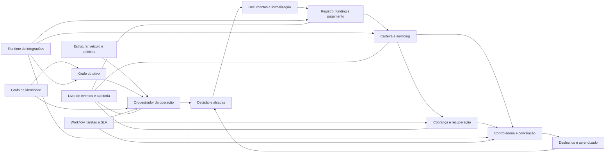

# STRATO — modelo de capacidades e implementação dos ciclos completos

> Blueprint de produto e arquitetura em 12/10/2026. Consolida a direção estratégica do STRATO, a implementação atual e as capacidades/regras identificadas nas 330 telas e 868 entradas do Help QProf. Não reproduz telas, textos, códigos históricos ou sequências proprietárias; converte necessidades operacionais em domínios, recursos e funções próprias do STRATO.

## 1. Decisão de produto consolidada

O STRATO deve permanecer uma **Receivables Operations Platform orientada por eventos e exceções**, e não se transformar em um ERP composto por módulos independentes.

A proposta de valor é executar o ciclo:

> identidade → ativo → operação → decisão → formalização → registro → pagamento → carteira → cobrança → liquidação → conciliação → aprendizado

com uma única fonte de dados, política versionada, evidência, estados explicáveis e intervenção humana apenas quando necessária.

### Fronteira do FIDC já decidida

FIDC faz parte do núcleo desde a primeira versão comercial, mas na perspectiva operacional da gestora, consultoria ou estrutura autorizada. Portanto, o STRATO deve modelar desde já:

- fundo, classe e subclasse;
- regulamento e política de investimento versionados;
- participantes e matriz de responsabilidades;
- elegibilidade, concentração e limites;
- pacote de cessão e evidências;
- posições recebidas do administrador/custodiante;
- PDD e conciliações operacionais;
- comunicação com administrador, custodiante e registradora.

O STRATO não deve presumir que calcula oficialmente cota/PL, mantém passivo de cotistas ou substitui obrigações regulatórias do administrador fiduciário. Essas responsabilidades só entram quando contratualmente atribuídas e juridicamente validadas.

## 2. Princípios que não podem ser perdidos

1. **Uma operação, uma área de trabalho.** As seis macroetapas continuam; rotinas auxiliares aparecem como filas, ações e evidências dentro do contexto.
2. **Uma pessoa, múltiplos papéis.** Cedente, sacado, cotista, fornecedor, avalista e representante são projeções da mesma identidade.
3. **Um recebível, vários eventos.** Nota, duplicata, registro, cessão, boleto, gravame, pagamento e baixa pertencem ao mesmo grafo de ativo.
4. **Regra não é tela.** Políticas têm código estável, versão, vigência, escopo, evidência e alçada.
5. **Estado não é descrição livre.** Toda transição relevante possui comando, pré-condição, evento e efeito compensatório.
6. **Nenhuma automação silenciosa.** O sistema mostra por que algo entrou, não entrou, foi bloqueado ou mudou.
7. **Integração é processo operacional.** Requisição, arquivo, transmissão, retorno, rejeição, retry, homologação e conciliação fazem parte do domínio.
8. **Financeiro é razão, não saldo editável.** Efeitos financeiros são lançamentos balanceados e estornos compensatórios.
9. **IA interpreta; domínio decide.** IA pode extrair, resumir e sugerir, mas política, cálculo, autorização e efeito permanecem determinísticos.
10. **FIDC é nativo, responsabilidades são configuráveis.** O modelo suporta o fundo sem assumir funções de terceiros regulados.

## 3. Modelo-alvo da plataforma

## 4. Estado atual versus modelo-alvo

| Capacidade | Estado atual | Para completar o ciclo |
|---|---|---|
| Identidade, sessão e acesso | Persistente e com escopo/alçadas | MFA, segregação maker-checker e auditoria de acesso ampliada |
| Cadastro de pessoas | Cadastro único e persistência iniciada | Grafo de relações, beneficiário final, documentos, KYC/PLD e prontidão temporal |
| Operação em seis etapas | Forte funcionalmente, estado local | Agregado persistente, comandos concorrentes, eventos e invalidadores de decisão |
| Entrada/normalização | XML/CSV e prévia; limites conscientes | XLSX real, layouts configurados, storage do original e lote persistente |
| Enriquecimento | Snapshot e proveniência demonstrativos | Jobs oficiais, evidência, validade, custo, retry e indisponibilidade real |
| Elegibilidade/políticas | Motor versionado e explicável forte | Políticas reais persistentes, laboratório, aprovação e execução produtiva |
| Decisões/alçadas | Ledger, idempotência e outbox persistentes | Expandir o padrão para ações materiais de todos os domínios |
| Documentos/assinatura | Checklist e registro manual | Hub documental, arquivo/hash/versão, templates, envelopes e evidências |
| Financeiro/contábil | Bom modelo de razão e estorno, estado local | Persistência transacional, fechamento, integração e conciliação produtiva |
| Carteira | Títulos, ocorrências, aging e confirmação | Máquina de estados completa, servicing bancário, instruções e posição oficial |
| Cobrança | Agenda, promessa e escalonamento derivados | Caso de cobrança, acordo, protesto, jurídico, régua e canais produtivos |
| Controladoria | Filas de checagem/formalização/conciliação | Evidência persistente, regras automáticas, PDD oficial e fechamento |
| Tarefas | Responsável, prazo, histórico e visibilidade | Workflow persistente, SLA, filas, delegação, escalonamento e calendário útil |
| Integrações | Catálogo e modos simulados | Runtime, credenciais, homologação, logs, retry, DLQ e reconciliação |
| FIDC | Conceitos dispersos de veículo/cotista | Fundo/classe/subclasse, responsabilidades, regulamento, posições e pacotes |
| Relatórios | Distribuídos nos módulos | Projeções persistentes, catálogo, filtros salvos, agendamento e distribuição |
| Portais | Ausentes | Portal de envio do cedente primeiro; investidor somente conforme escopo |

## 5. Ciclos ponta a ponta e o que implementar

## Ciclo 0 — configuração institucional e governança

### Objetivo

Definir quem opera, para qual empresa/veículo, sob quais responsabilidades, produtos, políticas, contas e integrações.

### Recursos de produto

- tenant e empresas operadoras;
- veículos: factoring, securitizadora, FIDC e ESC;
- fundo, classe/subclasse e séries quando aplicável;
- produtos/modalidades e regras fiscais travadas;
- participantes e matriz RACI por processo;
- calendários, feriados e prazos úteis;
- bancos, contas, carteiras, convênios e layouts;
- políticas, alçadas e segregação de funções;
- ambientes e homologações de integrações.

### Entidades principais

`Organization`, `Company`, `Vehicle`, `Fund`, `FundClass`, `Product`, `ResponsibilityAssignment`, `BankArrangement`, `BusinessCalendar`, `PolicyBinding`, `AuthorityAssignment`.

### Funções de domínio

- `registerCompanyProfile`
- `registerVehicle`
- `configureFundStructure`
- `assignParticipantResponsibility`
- `configureProduct`
- `configureBankArrangement`
- `resolveApplicablePolicy`
- `validateSegregationOfDuties`
- `activateConfigurationVersion`

### Eventos

`CompanyConfigured`, `VehicleActivated`, `FundStructureChanged`, `ResponsibilityAssigned`, `PolicyActivated`, `BankArrangementHomologated`.

### Critério de conclusão

Uma operação consegue determinar, sem campos livres, o veículo, produto, política, participantes responsáveis, contas e conectores aplicáveis na data de trabalho.

## Ciclo 1 — identidade, onboarding e prontidão

### Objetivo

Cadastrar uma pessoa uma vez, construir seus relacionamentos e pedir apenas o necessário para a próxima ação.

### Recursos de produto

- identidade PF/PJ deduplicada por documento;
- papéis e vigência;
- grupo econômico, sócios, administradores e beneficiários finais;
- procuradores, signatários, avalistas e garantidores;
- contatos por responsabilidade;
- contas bancárias e titularidade;
- documentos, validade e consentimentos;
- KYC/KYB, PLD/FT, PEP, sanções e revisões;
- contratos, produtos permitidos e limites;
- painel de prontidão por finalidade: simular, operar, assinar e receber.

### Entidades principais

`Party`, `PartyRole`, `PartyRelationship`, `EconomicGroup`, `BeneficialOwner`, `ContactPoint`, `BeneficiaryAccount`, `IdentityDocument`, `Consent`, `KycReview`, `PartyReadiness`.

### Funções de domínio

- `upsertPartyIdentity`
- `mergeDuplicateParty`
- `assignPartyRole`
- `linkPartyRelationship`
- `resolveEconomicGroup`
- `validateBeneficiaryAccount`
- `screenKycAndPld`
- `assessPartyReadiness`
- `schedulePeriodicReview`
- `suspendPartyCapability`

### Eventos

`PartyRegistered`, `PartyMerged`, `RoleAssigned`, `RelationshipLinked`, `KycScreened`, `BankAccountValidated`, `ReadinessChanged`, `PeriodicReviewDue`.

### Critério de conclusão

O sistema explica o que falta para cada uso e impede pagamento/assinatura quando o dado obrigatório está vencido, inconsistente ou não validado.

## Ciclo 2 — entrada, documentos e formação do ativo

### Objetivo

Receber arquivos/documentos por portal, API, XML, planilha ou digitação e criar ativos normalizados sem redigitação.

### Recursos de produto

- portal/API de envio;
- lote de entrada com original, hash e remetente;
- leitores versionados de XML, CSV, XLSX e layouts contratados;
- validação sintática e semântica;
- prévia e correção antes da criação;
- deduplicação intra-lote e contra carteira/operações;
- vínculo com cedente, sacado e documento fiscal;
- cadastro provisório controlado;
- grafo entre pedido, NF-e/CT-e/NFS-e, duplicata, contrato e título;
- quarentena de arquivo e fila de revisão.

### Entidades principais

`IntakeBatch`, `SourceFile`, `NormalizedRecord`, `Receivable`, `FiscalDocument`, `AssetRelationship`, `ImportIssue`, `ImportMapping`.

### Funções de domínio

- `createIntakeBatch`
- `storeSourceArtifact`
- `detectInputFormat`
- `normalizeInputRecord`
- `validateNormalizedRecord`
- `deduplicateReceivable`
- `linkFiscalEvidence`
- `createProvisionalParty`
- `previewOperationDraft`
- `commitOperationDraft`
- `quarantineBatch`

### Eventos

`BatchReceived`, `FileStored`, `RecordNormalized`, `DuplicateDetected`, `PartyProvisioned`, `ReceivableCreated`, `BatchCommitted`, `BatchRejected`.

### Critério de conclusão

O original e a transformação são reproduzíveis; nenhum arquivo é tratado como processado quando seu layout não foi reconhecido.

## Ciclo 3 — enriquecimento, risco e elegibilidade

### Objetivo

Qualificar os fatos, aplicar políticas vigentes e encaminhar somente exceções à pessoa competente.

### Recursos de produto

- orquestração de Receita, SEFAZ, bureau, PEP/sanções, registradora e custodiante;
- snapshot por operação com fonte, confiança, validade e custo;
- política em camadas: universal, modalidade, instituição, produto e carteira;
- elegibilidade de título, sacado, cedente, operação, carteira e estrutura;
- concentração e exposição projetada;
- alçada e override com validade;
- explicação positiva e negativa;
- laboratório contra carteira histórica;
- shadow mode antes de automatizar.

### Entidades principais

`EnrichmentJob`, `EvidenceSnapshot`, `Policy`, `PolicyVersion`, `PolicyRule`, `EligibilityRun`, `RuleEvaluation`, `ExceptionRequest`, `AuthorityGrant`.

### Funções de domínio

- `requestEnrichment`
- `normalizeProviderResult`
- `captureEvidenceSnapshot`
- `resolvePolicyLayers`
- `evaluateEligibility`
- `explainRuleOutcome`
- `requestExceptionDecision`
- `authorizeOverride`
- `invalidateStaleDecision`
- `simulatePolicyAgainstHistory`

### Eventos

`EnrichmentRequested`, `EvidenceObserved`, `EligibilityEvaluated`, `ExceptionRaised`, `OverrideGranted`, `DecisionInvalidated`, `PolicySimulationCompleted`.

### Critério de conclusão

Toda decisão informa política/versão, fatos, fontes, regras, valores observados, limites, ator, alçada e validade.

## Ciclo 4 — lastro, confirmação e controladoria prévia

### Objetivo

Comprovar existência, entrega e exigibilidade do recebível, usando amostragem proporcional ao risco.

### Recursos de produto

- checklist de lastro por produto/veículo;
- evidências fiscais e logísticas;
- confirmação de sacado multicanal;
- amostragem por política e risco;
- ocorrências tipadas e divergências;
- documentos/mercadorias pendentes;
- baixa automática somente com regra e evidência;
- fila de Controladoria com responsável e SLA;
- recomposição da amostra quando o lote muda.

### Entidades principais

`BackingRequirement`, `BackingEvidence`, `ConfirmationAttempt`, `SampleSelection`, `ControlException`, `Occurrence`.

### Funções de domínio

- `resolveBackingRequirements`
- `selectRiskSample`
- `validateFiscalEvidence`
- `requestDebtorConfirmation`
- `recordConfirmationOutcome`
- `registerTypedOccurrence`
- `openControlException`
- `evaluateAutomaticControlRelease`
- `invalidateBackingOnAssetChange`

### Eventos

`SampleSelected`, `BackingValidated`, `ConfirmationRequested`, `DebtorConfirmed`, `DivergenceFound`, `ControlReleaseGranted`, `BackingInvalidated`.

### Critério de conclusão

Cada título possui lastro/evidência suficiente ou uma exceção explícita; mudança material invalida confirmações dependentes.

## Ciclo 5 — preço, estrutura, aprovação e reserva

### Objetivo

Montar a condição econômica reproduzível, validar caixa/funding e obter a decisão humana exigida.

### Recursos de produto

- simulação de cenários;
- deságio, tarifas, retenções, impostos e custo de funding;
- valor presente, taxa efetiva e all-in;
- conta gráfica e retenção para recompra;
- estrutura FIDC/classe/subclasse;
- capacidade de caixa e funding;
- reserva de limite e liquidez;
- aprovação em cascata e decisão individual quando necessária;
- condições precedentes.

### Entidades principais

`PricingScenario`, `OperationTerms`, `Fee`, `Tax`, `Retention`, `LimitReservation`, `FundingReservation`, `ApprovalCase`, `PrecedentCondition`.

### Funções de domínio

- `calculatePricingScenario`
- `comparePricingScenarios`
- `resolveTaxTreatment`
- `calculateRetentions`
- `validateCashCapacity`
- `reserveCreditLimit`
- `reserveFunding`
- `buildApprovalCase`
- `approveAtRequiredAuthority`
- `releaseOrExpireReservation`

### Eventos

`PricingCalculated`, `TermsSelected`, `LimitReserved`, `FundingReserved`, `ApprovalRequested`, `OperationApproved`, `ConditionPrecedentOpened`, `ReservationExpired`.

### Critério de conclusão

O líquido, receitas, impostos, retenções, funding e efeitos contábeis são reproduzíveis e estão congelados na versão aprovada.

## Ciclo 6 — documentos, assinatura e formalização

### Objetivo

Transformar a decisão aprovada em pacote jurídico completo, íntegro e verificável.

### Recursos de produto

- repositório documental com arquivo, hash, versão e classificação;
- templates versionados por produto/veículo;
- geração de contrato, borderô, termo de cessão e anexos;
- checklist dinâmico;
- assinantes, ordem e regra de assinatura;
- envelopes do provedor, expiração, recusa e reenvio;
- assinatura manual com arquivo/evidência real;
- retenção, acesso, legal hold e descarte;
- pacote de cessão para FIDC/custodiante.

### Entidades principais

`Document`, `DocumentVersion`, `DocumentTemplate`, `FormalizationPackage`, `SignatureEnvelope`, `Signer`, `SignatureEvidence`, `RetentionRule`.

### Funções de domínio

- `resolveRequiredDocuments`
- `generateDocumentFromTemplate`
- `attachExternalDocument`
- `verifyDocumentIntegrity`
- `buildFormalizationPackage`
- `createSignatureEnvelope`
- `applySignatureProviderEvent`
- `recordManualSignatureEvidence`
- `verifyFormalizationCompletion`
- `archiveDocument`

### Eventos

`DocumentGenerated`, `DocumentAttached`, `PackageBuilt`, `EnvelopeSent`, `DocumentSigned`, `SignatureRefused`, `FormalizationCompleted`, `DocumentArchived`.

### Critério de conclusão

Nenhum status “Pronto” ou “Assinado” existe sem artefato, hash, origem, ator e evidência correspondente.

## Ciclo 7 — registro, instrução, funding e pagamento

### Objetivo

Registrar/ceder os ativos, preparar a cobrança e liberar recursos com segurança e segregação.

### Recursos de produto

- registro/escrituração e gravames;
- pacote para custodiante/administrador;
- conta e carteira bancária aplicável;
- Nosso Número, boleto e Pix;
- remessa CNAB/API e instruções bancárias;
- ordem de pagamento com maker-checker;
- validação de favorecido/titularidade;
- funding e conta vinculada/escrow;
- lançamento contábil da aquisição;
- confirmação externa antes de travar devolução.

### Entidades principais

`RegistrationRequest`, `AssignmentPackage`, `CollectionInstruction`, `RemittanceBatch`, `PaymentOrder`, `FundingDraw`, `EscrowAccount`, `BankConfirmation`.

### Funções de domínio

- `registerReceivable`
- `createAssignmentPackage`
- `resolveCollectionArrangement`
- `assignOurNumber`
- `issueBillingInstrument`
- `buildBankRemittance`
- `validateRemittanceItem`
- `submitPaymentOrder`
- `approvePaymentOrder`
- `confirmBankRegistration`
- `postReceivablePurchase`

### Eventos

`RegistrationRequested`, `ReceivableRegistered`, `RemittanceGenerated`, `RemittanceSubmitted`, `PaymentOrdered`, `PaymentApproved`, `PaymentConfirmed`, `PurchasePosted`.

### Critério de conclusão

Operação, registro, cobrança bancária, pagamento e razão permanecem correlacionados e idempotentes, inclusive em retry ou retorno duplicado.

## Ciclo 8 — carteira, servicing, retorno e liquidação

### Objetivo

Manter a posição oficial de cada recebível e aplicar retornos sem atualizações silenciosas.

### Recursos de produto

- posição por título/cedente/sacado/veículo;
- máquina de estados separando situação do título, banco, custódia, registro e contabilidade;
- ingestão e validação de retorno CNAB/API;
- instruções: prorrogação, abatimento, baixa, protesto e alteração de carteira;
- pagamentos total/parcial, juros, multa e desconto;
- identificação de créditos e conciliação;
- saldo e exposição por data-base;
- PDD com política, posição e memória;
- posição recebida de custodiante/administrador e divergências.

### Entidades principais

`PortfolioTitle`, `TitleState`, `BankInstruction`, `BankReturnBatch`, `Settlement`, `CustodyPosition`, `ReconciliationCase`, `ProvisionRun`.

### Funções de domínio

- `activatePortfolioTitle`
- `requestBankInstruction`
- `parseBankReturn`
- `applyBankReturnEvent`
- `settleTitle`
- `settleTitlePartially`
- `reverseSettlement`
- `changeCollectionArrangement`
- `reconcileBankMovement`
- `compareCustodyPosition`
- `calculateProvision`

### Eventos

`TitleActivated`, `InstructionRequested`, `BankReturnReceived`, `TitleSettled`, `PartialSettlementApplied`, `SettlementReversed`, `CustodyDivergenceFound`, `ProvisionCalculated`.

### Critério de conclusão

É possível explicar a posição do título em qualquer data, incluindo arquivo/retorno, instruções, pagamentos, baixas, reversões e lançamentos.

## Ciclo 9 — cobrança, acordo, protesto e recuperação

### Objetivo

Conduzir a recuperação em um único caso, do preventivo ao jurídico, preservando efeitos financeiros e evidências.

### Recursos de produto

- caso de cobrança por obrigação/devedor;
- régua configurável por atraso, risco, produto e veículo;
- contatos, canais, consentimentos e entrega;
- promessas e retornos;
- acordo com parcelas, juros, desconto e aprovação;
- prorrogação e efeitos contábeis;
- confissão de dívida e garantias;
- protesto/IEPTB: remessa, retorno, rejeição, custas e cancelamento;
- negativação, cobrança externa e jurídico;
- recompra integral/parcial e conta gráfica;
- mensuração de recuperação e estratégia.

### Entidades principais

`CollectionCase`, `CollectionStrategy`, `ContactAttempt`, `PaymentPromise`, `Agreement`, `AgreementInstallment`, `DebtConfession`, `ProtestCase`, `LegalCase`, `Repurchase`.

### Funções de domínio

- `openCollectionCase`
- `selectCollectionStrategy`
- `scheduleCollectionAction`
- `recordContactAttempt`
- `recordPaymentPromise`
- `markBrokenPromise`
- `proposeAgreement`
- `approveAgreement`
- `activateAgreement`
- `issueProtest`
- `applyIeptbReturn`
- `requestRepurchase`
- `executeRepurchase`
- `referToLegalCollection`

### Eventos

`CollectionCaseOpened`, `ContactRecorded`, `PromiseMade`, `PromiseBroken`, `AgreementProposed`, `AgreementActivated`, `ProtestRequested`, `ProtestConfirmed`, `RepurchaseExecuted`, `LegalCaseOpened`.

### Critério de conclusão

Promessa, acordo, protesto, recompra e jurídico compartilham linha do tempo, responsáveis, documentos e efeitos; não são módulos isolados.

## Ciclo 10 — financeiro, contabilidade e controladoria posterior

### Objetivo

Fechar o ciclo do dinheiro e permitir auditoria, conciliação e exportação sem planilha paralela.

### Recursos de produto

- contas a pagar/receber;
- razão de partidas dobradas;
- movimentos e extratos bancários;
- conciliação financeira e operacional;
- conta gráfica do cedente;
- apropriação de receita e provisões;
- impostos/guias conforme natureza validada;
- fechamento por período e bloqueio;
- exportação contábil;
- trilha de estorno e reabertura;
- relatórios de liquidez, aging, safra, concentração e resultado.

### Entidades principais

`FinancialTitle`, `BankMovement`, `StatementLine`, `JournalEntry`, `CedentLedger`, `AccrualSchedule`, `AccountingPeriod`, `AccountingExport`.

### Funções de domínio

- `createFinancialObligation`
- `postJournalEntry`
- `validateBalancedEntry`
- `applyCedentLedgerEvent`
- `accrueDiscountRevenue`
- `postProvision`
- `reconcileOperationalAndFinancialState`
- `closeAccountingPeriod`
- `reopenPeriodWithAuthority`
- `exportAccountingBatch`

### Eventos

`FinancialTitleCreated`, `JournalPosted`, `BankMovementMatched`, `CedentLedgerDebited`, `RevenueAccrued`, `PeriodClosed`, `AccountingBatchExported`.

### Critério de conclusão

Saldo, posição e contabilidade se reconciliam por eventos de origem; exclusão física e edição retroativa de lançamento são proibidas.

## Ciclo 11 — desfecho, qualidade e retroalimentação

### Objetivo

Fazer liquidação, atraso, divergência, fraude, recompra e recuperação melhorarem as próximas decisões.

### Recursos de produto

- histórico de desempenho por cedente/sacado/grupo;
- roll rate, vintage, concentração e liquidez;
- qualidade de lastro e confirmação;
- desempenho por política vigente;
- comparação decisão versus desfecho;
- revisão programada de limite/política;
- laboratório de política e shadow mode;
- dataset governado para modelos futuros.

### Entidades principais

`OutcomeObservation`, `QualityMetric`, `PolicyPerformance`, `ReviewTrigger`, `ModelDataset`, `DriftObservation`.

### Funções de domínio

- `recordOperationOutcome`
- `recalculatePartyQuality`
- `calculatePortfolioDynamics`
- `measurePolicyPerformance`
- `scheduleLimitReview`
- `compareDecisionWithOutcome`
- `publishGovernedTrainingExample`
- `detectPolicyDrift`

### Eventos

`OutcomeObserved`, `QualityChanged`, `LimitReviewDue`, `PolicyPerformanceUpdated`, `DecisionDivergenceDetected`, `PolicyDriftDetected`.

### Critério de conclusão

O sistema demonstra quais resultados alteraram score, limite, amostragem ou política e nunca reescreve a decisão histórica.

## 6. Infraestruturas transversais obrigatórias

## 6.1 Runtime de integrações

Recursos:

- `IntegrationProvider`, `ConnectorVersion`, `CredentialReference`, `IntegrationEnvironment`;
- `IntegrationJob`, `ExternalMessage`, `IntegrationAttempt`, `DeadLetter`;
- homologação por banco/produto/layout/ambiente;
- segredo somente no servidor;
- idempotência, assinatura, retry e circuit breaker;
- painel de disponibilidade, latência, sucesso, rejeição e backlog;
- armazenamento seguro de payload bruto e resposta normalizada;
- reprocessamento autorizado e correlação com agregado.

Estados mínimos de disponibilidade:

`PLANNED`, `DEVELOPING`, `HOMOLOGATION`, `HOMOLOGATED`, `ACTIVE`, `DEGRADED`, `SUSPENDED`, `LEGACY`.

## 6.2 Hub documental

Recursos:

- storage de objeto com hash e antivírus;
- metadados e versões no banco;
- classificação, retenção e permissão;
- template e geração;
- evidência de assinatura;
- vínculo polimórfico com pessoa, operação, título, garantia, decisão e caso de cobrança;
- OCR/extrator como job, nunca como alteração do original.

## 6.3 Workflow, tarefas e SLA

Recursos:

- templates de processo e versões;
- fila, grupo, responsável, aceite, delegação e substituição;
- calendário útil, SLA e escalonamento;
- guardas chamando funções do domínio;
- formulário/evidência exigida;
- compensação e reabertura;
- métricas de espera, trabalho, retrabalho e gargalo.

O workflow coordena; não decide elegibilidade, preço, contabilização ou autorização.

## 6.4 Livro de eventos e projeções

Recursos:

- eventos append-only por tenant/agregado;
- versão otimista;
- comando e chave de idempotência;
- outbox transacional;
- projeções reconstruíveis para telas, filas e relatórios;
- correlation/causation ID;
- política de retenção e exportação de auditoria.

Não é obrigatório adotar event sourcing integral em todos os agregados. É obrigatório registrar eventos materiais e impedir efeitos duplicados.

## 6.5 Catálogos e parâmetros

Recursos:

- catálogos simples para listas/classificações;
- modelos tipados para regras financeiras, fiscais e regulatórias;
- escopo por tenant, empresa, veículo, produto e carteira;
- vigência, aprovação, versão e comparação;
- importação/exportação governada;
- referência por ID estável.

## 6.6 Relatórios e consulta

Recursos:

- projeções por domínio;
- filtros salvos e compartilhados;
- exportação assíncrona;
- agendamento e distribuição autorizada;
- mascaramento;
- snapshot de parâmetros/versão;
- API analítica governada.

## 7. Recursos/API sugeridos

Os nomes abaixo são contratos conceituais; a implementação pode usar REST/comandos sem acoplar a interface ao banco.

| Recurso | Responsabilidade |
|---|---|
| `/companies`, `/vehicles`, `/funds`, `/fund-classes` | Estrutura institucional e FIDC |
| `/products`, `/responsibilities`, `/policy-bindings` | Produto, participantes e regras aplicáveis |
| `/parties`, `/party-relationships`, `/kyc-reviews`, `/readiness` | Identidade e onboarding |
| `/documents`, `/document-packages`, `/signature-envelopes` | Evidência e formalização |
| `/intake-batches`, `/source-files`, `/receivables` | Entrada e grafo do ativo |
| `/operations`, `/operation-commands`, `/operation-events` | Esteira e transições |
| `/enrichment-jobs`, `/evidence-snapshots` | Fontes externas e proveniência |
| `/policies`, `/eligibility-runs`, `/exception-decisions` | Motor e alçadas |
| `/registrations`, `/assignment-packages` | Registro e cessão |
| `/bank-arrangements`, `/remittances`, `/bank-returns`, `/payment-orders` | Orquestração bancária |
| `/portfolio-titles`, `/bank-instructions`, `/settlements` | Servicing da carteira |
| `/collection-cases`, `/promises`, `/agreements`, `/protests`, `/repurchases` | Recuperação |
| `/financial-titles`, `/bank-movements`, `/journal-entries`, `/periods` | Financeiro/contábil |
| `/custody-positions`, `/reconciliation-cases`, `/provision-runs` | Controladoria/FIDC |
| `/tasks`, `/workflow-instances`, `/sla-breaches` | Trabalho operacional |
| `/integration-jobs`, `/external-messages`, `/dead-letters` | Integrações |
| `/reports`, `/report-runs`, `/saved-filters` | Informação governada |

## 8. Modelo mínimo de persistência por agregado

Cada agregado produtivo deve ter:

- `tenant_id` e escopo de empresa/veículo;
- ID estável e documento externo quando aplicável;
- `version` para concorrência otimista;
- estado atual validado;
- `created_at/by` e `updated_at/by`;
- eventos materiais append-only;
- comandos idempotentes;
- referência à política/configuração vigente;
- correlation ID para efeitos externos;
- projeção de leitura separada quando o volume justificar.

Agregados prioritários:

1. `Operation`;
2. `Receivable`/`PortfolioTitle`;
3. `FinancialLedger` e `BankAccount`;
4. `Policy`;
5. `Task`/`WorkflowInstance`;
6. `Document`/`FormalizationPackage`;
7. `IntegrationJob`/`ExternalMessage`;
8. `CollectionCase`;
9. `Vehicle`/`FundStructure`.

## 9. Ordem de implementação recomendada

## Onda A — substrato produtivo

1. persistir Operação e títulos com versão/tenant/veículo;
2. persistir Financeiro, Carteira, Comercial, políticas e tarefas;
3. expandir ledger de eventos/outbox para todos os comandos materiais;
4. implementar storage de documentos e arquivos de entrada;
5. fechar autorização, maker-checker e escopo em todas as APIs.

**Saída:** dois usuários operam simultaneamente e o estado sobrevive/reproduz em qualquer dispositivo.

## Onda B — cunha comercial completa

1. estrutura de empresa/veículo/fundo/classe e responsabilidades;
2. onboarding/prontidão do cedente;
3. entrada produtiva XML/CSV/XLSX/API;
4. enriquecimentos essenciais;
5. políticas reais e aprovação;
6. hub documental e assinatura;
7. pacote de cessão/registro e pagamento.

**Saída:** duplicata mercantil vai do arquivo à liberação com trilha completa para factoring, securitizadora e FIDC.

## Onda C — fechar o ciclo do dinheiro

1. runtime de integrações;
2. primeiro banco/layout produtivo;
3. boleto/Nosso Número, remessa, retorno e instruções;
4. conciliação bancária;
5. conta gráfica e recompra;
6. caso de cobrança, promessa, acordo e protesto/IEPTB;
7. exportação contábil.

**Saída:** operação liberada é registrada, cobrada, liquidada, conciliada ou recuperada sem planilha paralela.

## Onda D — escala, FIDC e controle

1. posição de custodiante/administrador e reconciliação;
2. PDD com posição/data-base/política;
3. Duplicata Escritural e registradoras;
4. workflow/SLA completo;
5. relatórios agendados e API analítica;
6. portal do cedente;
7. múltiplas classes/subclasses e pacotes regulatórios conforme responsabilidade.

**Saída:** o mesmo núcleo sustenta escala operacional e estrutura FIDC sem assumir indevidamente funções reguladas.

## Onda E — aprendizado e automação avançada

1. laboratório de políticas;
2. safras, roll rates e previsão de liquidez;
3. shadow mode e comparação decisão/desfecho;
4. detecção de fraude/anomalia;
5. copiloto com fontes e ações autorizadas;
6. portais adicionais quando houver demanda validada.

## 10. Recortes que não devem entrar no núcleo

- help desk corporativo;
- compras, patrimônio e RDV genéricos;
- administração completa do passivo do fundo sem decisão jurídica/comercial;
- OData como interface primária;
- uma tela separada para cada consulta ou cadastro auxiliar;
- códigos históricos como comandos de negócio;
- estados manuais sem evento/evidência;
- integração específica dentro do agregado da operação;
- regras regulatórias ou tributárias fixas sem versão e validação profissional.

Essas necessidades podem ser atendidas por integração, projeção, catálogo ou produto adicional.

## 11. Definition of Done do ciclo completo

Um fluxo só está completo quando:

1. começa por canal produtivo e preserva o original;
2. usa identidade/ativo sem duplicação;
3. resolve configuração e política vigentes;
4. explica aprovações, alertas, bloqueios e exclusões;
5. respeita alçada, segregação e escopo;
6. produz documentos/evidências verificáveis;
7. executa efeitos externos com idempotência e retorno;
8. contabiliza de forma balanceada;
9. possui compensação/estorno, sem apagar histórico;
10. entra em carteira e é conciliado até liquidação ou recuperação;
11. retroalimenta qualidade e revisão sem reescrever o passado;
12. gera métricas de tempo, toque, falha, custo e desfecho.

## 12. Métricas norteadoras

- percentual de operações liberadas dentro da política, sem retrabalho e com trilha completa;
- tempo de ciclo e tempo parado por dependência;
- intervenções humanas por operação/título;
- percentual de processamento sem toque;
- falha, retry e rejeição por conector/layout;
- conciliação automática;
- formalização com evidência integral;
- atraso, recompra, perda e recuperação por política;
- divergência entre STRATO, banco, custodiante e administrador;
- cumprimento de SLA;
- custo operacional por operação e título;
- decisões invalidadas por mudança de dado/política;
- capacidade de reproduzir posição, saldo e decisão em auditoria.

## 13. Parecer de implementação

O STRATO já contém a maior parte das ideias difíceis: seis etapas coerentes, cadastro único, motor versionado, gestão por exceção, razão financeiro, carteira, decisões append-only e outbox. O trabalho prioritário não é redesenhar a experiência nem criar módulos em massa. É:

1. persistir os agregados existentes;
2. criar o grafo do ativo e o hub documental;
3. implantar runtime de integrações e banking orchestration;
4. transformar cobrança em caso completo;
5. tornar workflow/SLA e Controladoria produtivos;
6. modelar FIDC/participantes/responsabilidades no núcleo;
7. fechar a retroalimentação por eventos de desfecho.

Essa sequência completa os ciclos sem abandonar a direção do produto e absorve a maturidade operacional observada no QProf sem copiar sua arquitetura de telas.
